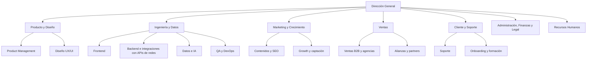

# 01 · Análisis y documentación inicial (RA1)

## 1. Sector y empresas (CE 1a, 1b)

|Empresa| Tamaño | Forma | Ámbito | Servicio | Fuente y fecha | Estado |
|---|---|---|---|---|---|---|
| [Metricool](https://metricool.com/es/que-es-metricool/) | +100 empleados | Scale-up tecnológica de origen español en rápido crecimiento. Estructura dinámica orientada a producto (Product-Led Growth) | Origen español; expansión internacional | Plataforma todo-en-uno de analítica, planificación, gestión de campañas de anuncios y generación automática de informes para agencias y freelancers. | [ir](https://es.wikipedia.org/wiki/Metricool) — 2026-11-18 | `leído` |
| [Agorapulse](https://www.agorapulse.com/es/) | Empresa mediana (aprox 200 empleados) | De capital privado. Organización híbrida con fuerte enfoque en soporte al cliente y éxito del usuario | Distribución internacional | Herramienta centrada en la gestión de comunidades, CRM social y colaboración directa con clientes. | [ir](https://dealroom.co/companies/agorapulse/) — 2026-11-18 | `leído` |
| [Sendible](https://www.sendible.com) | Pyme con un equipo reducido (11-50 empleados) | Pyme tecnológica (fundada en 2009). Pertenece al grupo Traject desde su adquisición en 2021 y funciona con un modelo *remote-first* | Británica | Plataforma de gestión de redes sociales para agencias y marcas con muchas cuentas: programación, bandeja de entrada, informes | [ir](https://www.linkedin.com/company/sendible/about/) — 2026-11-18 | `leído` |
| [Sprout Social](https://sproutsocial.com/es/) | +1.300 empleados (Enterprise) | Corporación pública. Estructura jerárquica funcional con fuertes divisiones de ventas B2B (Enterprise Sales) e ingeniería de datos | Estados nidos, Polonia e Irlanda | Plataforma integral de nivel empresarial con foco en inteligencia de negocio, social listening avanzado y gestión de grandes equipos. | [ir](https://www.linkedin.com/company/sprout-social-inc-/about/) — 2026-11-18 | `leído` |
| [Hootsuite](https://www.hootsuite.com/lp/hootsuite) | Empresa de gran escala (aprox 1.000 empleados) | Organización matricial orientada a cuentas corporativas y alianzas estratégicas | Presencia global | Suite todo-en-uno para programación multicanal, publicidad social (Social Ads). | [ir](https://www.reveliolabs.com/companies/hootsuite/employees/) — 2026-11-18 | `leído` |
| [Planable](https://planable.io) | Aprox 60 empleados | Startup ágil (fundada en 2016) con estructura horizontal y ciclos rápidos de desarrollo de software | Estados Unidos | Software especializado en la colaboración visual, vista previa de feeds y flujos de aprobación de contenido entre agencias y clientes. | [ir](https://start-up.ro/rd36869) — 2026-11-18 | `leído` |
| [Later](https://later.com) | Unos 300 empleados antes de su última adquisición | Adquirida en 2022 por Mavrck y unificada bajo la marca Later en 2024 | Origen canadiense (fundada en 2014 como Latergramme); equipo remoto con centros en Boston, Toronto y Vancouver | Planificación visual y programación de contenidos (Later Social), marketing de influencers (Later Influence) con foco en Instagram y TikTok para marcas y creadores. | [ir](https://techcouver.com/2022/04/27/later-acquired-by-mavrck/) — 2026-11-18 | `leído` |
| [Buffer](https://buffer.com) | Empresa pequeña (aprox 70 empleados) | Pionera en trabajo 100 % remoto y cultura transparente. Estructura plana, ágil y con equipos autónomos reducidos (squads) | Global Team | Herramienta minimalista enfocada en la publicación sencilla, analítica básica y gestión ágil para creadores y pequeñas empresas. | [ir](https://www.linkedin.com/company/bufferapp/about/) — 2026-11-18| `leído` |
| [Publer](https://publer.io) | Equipo pequeño de unas pocas decenas de personas | Pyme autofinanciada (bootstrapped) (fundada entre 2015 y 2017), estructura plana orientada a producto | De origen albanés | Programación y analítica multired a bajo coste: calendario visual, publicación masiva, reciclado de publicaciones, asistente de IA y colaboración en equipo, orientada a freelancers y pequeñas agencias. | [ir](https://www.gartner.com/reviews/product/publer/) — 2026-11-18 | `leído` |

**Empresa tipo: scale-up SaaS de gestión de redes sociales.** Es un modelo representativo construido a partir de las empresas anteriores (Metricool, Sendible, Buffer, Publer): una compañía de software como servicio (SaaS) de entre 50 y 150 personas, organizada por funciones con equipos de producto pequeños y trabajo híbrido o remoto.

| Departamento | Funciones principales |
|---|---|
| Dirección General | Define la estrategia y la visión del producto, fija objetivos y gestiona la relación con inversores o socios. |
| Producto y Diseño | Decide qué se construye y en qué orden (hoja de ruta), recoge necesidades de los usuarios y diseña la experiencia y la interfaz. |
| Ingeniería y Datos | Desarrolla y mantiene la plataforma (frontend, backend), integra las APIs de las redes sociales, entrena o integra funciones de IA, prueba el software y gestiona el despliegue y la disponibilidad. |
| Marketing y Crecimiento | Atrae usuarios mediante contenidos, SEO, campañas y pruebas de crecimiento; mide la conversión del registro a cliente de pago. |
| Ventas y Alianzas | Vende los planes a agencias y empresas, negocia acuerdos con partners e integraciones y gestiona las cuentas de mayor tamaño. |
| Cliente y Soporte | Resuelve incidencias, forma a los nuevos clientes (onboarding), reduce la baja de clientes (*churn*) y traslada sus peticiones a Producto. |
| Administración, Finanzas y Legal | Controla facturación, cobros, presupuestos y contabilidad; se ocupa de contratos, protección de datos y normativa. |
| Recursos Humanos | Selecciona, forma y retiene al equipo; gestiona contratos, nóminas y prevención de riesgos laborales. |

## 2. Necesidades y oportunidades (CE 1c, 1d)

1. **Automatización y escalado de la creación de contenido mediante IA generativa**
Es la necesidad con mayor impacto directo en la reducción de costes operativos por cliente. Permite multiplicar el volumen de publicaciones sin incrementar proporcionalmente las horas de trabajo.
2. **Flujos de aprobación de clientes centralizados y sin fricción (Client Approval Workflows)** Crítico para la retención de cuentas. Los retrasos en la validación por parte del cliente son la causa número uno de cuellos de botella e ineficiencia en las agencias.
3. **Bandeja de entrada unificada de atención al cliente y comunidad (Social Inbox multicanal)** Alto impacto en la reputación de marca. Los consumidores exigen respuestas casi instantáneas (el 73% abandona o cambia de marca si no recibe respuesta rápida en redes).
4. **Generación automática de informes de ROI y analíticas personalizables (White-label)** Necesidad administrativa recurrente. Demostrar el retorno de inversión mes a mes es el factor determinante para evitar la cancelación (churn) de los clientes de una agencia.

**Criterio de priorización.** Las necesidades se ordenan por su impacto económico para un community manager o una agencia pequeña: reducción de costes por cliente, retención de cuentas y protección de la reputación. A igual impacto, se prioriza la que resulta abordable en un proyecto de unos 2 a 4 meses.

**Oportunidades de negocio.** El mercado del software de gestión de redes sociales crece de forma sostenida: Mordor Intelligence lo valora en **19.840 millones de USD en 2025** y prevé **42.760 millones en 2031**, con un crecimiento anual compuesto (CAGR) del **14,2 %**; además, la modalidad en la nube ya supone el 61,23 % del mercado. Otras consultoras publican previsiones más altas (hasta un 25,35 % de CAGR según 360iResearch), por lo que se toma la cifra más conservadora como referencia. Dentro de este mercado, la oportunidad de CMapp está en el nicho de freelancers y pequeñas agencias de habla hispana que hoy combinan hojas de cálculo, Notion o Trello con herramientas generalistas, y que necesitan unir en un mismo sitio la planificación, la aprobación del cliente y los presupuestos.

_Fuentes:_
- [Hootsuite - Social Trends](https://www.hootsuite.com/es/research/social-trends)
- [Sprout Social: The state of social media 2026](https://sproutsocial.com/insights/the-state-of-social-media/)
- [Hubspot - Marketing Statistics](https://www.hubspot.com/marketing-statistics)
- [Capterra - Sales and Marketinh Software Trends](https://www.capterra.com/resources/sales-and-marketing-software-trends/)
- [SproutSocial - Social Media Customer Statistics](https://sproutsocial.com/insights/social-media-customer-service-statistics/)
- [Mordor Intelligence - Social Media Management Software Market (2026-2031)](https://www.giiresearch.com/report/moi2118208-social-media-management-software-market-share.html)
- [360iResearch - Social Media Management Market (2026-2032)](https://www.marketresearch.com/360iResearch-v4164/Social-Media-Management-Solution-Type-43429023)

## 3. Tipo de proyecto elegido (CE 1e)

**Mi proyecto: CMapp**

Aplicación web de gestión profesional y flujos de trabajo, orientada específicamente a community managers autónomos y pequeñas agencias. El sistema centraliza la gestión de cuentas de múltiples clientes, la planificación de contenidos en calendario, el circuito formal de aprobación de publicaciones y el control de presupuestos/contratos.

Mi objetivo es transformar la gestión de redes sociales en un servicio transparente y orientado a resultados, dotando al cliente de un panel de control interactivo en tiempo real que visibilice el impacto de las publicaciones, justifique el retorno de la inversión (ROI) y consolide la relación de confianza a largo plazo.

**Alternativas consideradas.** Seguir con Notion o Trello sirve al community manager, pero obliga a preparar para cada cliente una presentación en PDF con el resumen de las publicaciones (doble trabajo) y no deja un registro claro de lo aprobado. Las herramientas comerciales (Metricool, Planable, Buffer, Publer y otras, comparadas en [`01b-sota.md`](01b-sota.md)) cobran por marca, canal o espacio de trabajo y, en las páginas consultadas, no integran presupuestos con aceptación del cliente.

## 4. Requisitos y restricciones (CE 1f)

| ID | Requisito | Tipo (funcional / no funcional / restricción) | Cómo se verifica |
|---|---|---|---|
| **RF-01** | El sistema debe permitir el registro e inicio de sesión de usuarios diferenciando el rol de Community Manager y el rol de Cliente. | funcional | Comprobar mediante pruebas de autenticación con credenciales válidas e inválidas que cada rol accede exclusivamente a su panel correspondiente. |
| **RF-02** | El Community Manager debe poder dar de alta, editar y listar los clientes y sus respectivas cuentas. | funcional | Verificar a través de la interfaz web la correcta inserción, modificación y listado de los registros en la base de datos MySQL. |
| **RF-03** | El sistema debe proporcionar un calendario de contenido para registrar imágenes, fecha, hora de publicación y copy. | funcional | Crear una nueva pieza de contenido y comprobar que se almacena y se visualiza correctamente en la agenda o calendario editorial. |
| **RF-04** | El cliente debe disponer de un flujo de aprobación interactivo para aprobar (por partes o completo), pedir cambios o rechazar publicaciones. | funcional | Iniciar sesión como cliente, modificar el estado de una pieza de contenido y comprobar que el cambio se actualiza y registra de forma inmediata. |
| **RF-05** | El sistema debe permitir la creación de presupuestos por parte del CM y su posterior aceptación por parte del cliente desde la aplicación. | funcional | Generar un presupuesto con el rol CM, acceder con el perfil del cliente, pulsar el botón de aceptación y validar que el estado cambia a "Aceptado". |
| **RF-06** | Ampliación (no imprescindible): el Community Manager debe poder generar propuestas de copy para una publicación mediante una API de inteligencia artificial y editarlas antes de guardarlas; el sistema no enviará a la API datos personales de clientes. | funcional | Desde el formulario de una publicación, solicitar un copy indicando tema y tono y comprobar que se muestra una propuesta editable que solo se guarda al confirmarla; con la API desconectada, comprobar que aparece un mensaje de error y que el copy se puede escribir a mano. |
| **RF-07** | Ampliación (no imprescindible): el sistema debe mostrar en un panel (*dashboard*) estadísticas por cuenta (publicaciones por estado y por mes, y métricas de resultados) y permitir al CM enviar cada mes al cliente una propuesta de ideas para el mes siguiente, que el cliente revisa con el flujo de RF-04. | funcional | Registrar datos de ejemplo de tres cuentas y comprobar que el panel muestra los totales y la evolución mensual de cada una y que cada cliente solo ve las suyas; crear una propuesta mensual de ideas como CM y comprobar que el cliente puede aprobarla o rechazarla. |
| **RNF-01** | Seguridad y control de acceso: los clientes solo pueden visualizar los datos, contratos y contenidos estrictamente asignados a su cuenta. | no funcional | Intentar acceder mediante una URL forzada a los recursos de otro cliente y verificar que el sistema deniega el acceso (Error 403 o redirección). |
| **RNF-02** | Rendimiento: las páginas y solicitudes principales de la aplicación deben cargar y responder en menos de 2 segundos bajo condiciones normales. | no funcional | Medir el tiempo de carga y respuesta de las rutas principales utilizando la pestaña de Red (*Network*) de las herramientas de desarrollo del navegador o Lighthouse. |
| **RNF-03** | Usabilidad y adaptabilidad (*responsive design*): la interfaz debe ajustarse correctamente a dispositivos móviles, tablets y escritorios mediante Tailwind CSS / CSS. | no funcional | Comprobar visualmente la interfaz simulando diferentes resoluciones de pantalla (desde 375px hasta 1280px) sin que se rompa la maquetación. |
| **REST-01** | Tecnología: el proyecto debe desarrollarse empleando PHP, el framework Laravel, base de datos MySQL y JavaScript para la interactividad. | restricción | Inspeccionar el repositorio de código fuente y el archivo de dependencias (`composer.json`) para certificar el uso de la pila tecnológica exigida. |
| **REST-02** | Plazo de desarrollo limitado al calendario académico del ciclo formativo de DAW (curso 2026-27), entregando el proyecto por hitos temporales. | restricción | Cumplimiento de las fechas de entrega establecidas en las convocatorias de seguimiento del proyecto final. |
| **REST-03** | Política de datos: la aplicación no utilizará datos personales reales, empleando exclusivamente información de ejemplo o ficticia. | restricción | Revisar la base de datos y los registros de prueba (*seeders*) para confirmar que no contienen datos sensibles reales. |

### Matriz de trazabilidad

| Objetivo | Requisito | Caso de uso | Pantalla o endpoint | Prueba o indicador |
|---|---|---|---|---|
| **OBJ-01** | **Control de acceso y roles:** Diferenciar el entorno de trabajo del Community Manager y el portal del cliente. | **RF-01** | El sistema debe permitir el registro e inicio de sesión de usuarios diferenciando el rol de Community Manager y el rol de Cliente. | *CU-01* | *POST /register, POST /login* | *P-01* |
| **OBJ-01** | Control de acceso y roles. | **RNF-01** | Seguridad y control de acceso: los clientes solo pueden visualizar los datos, contratos y contenidos estrictamente asignados a su cuenta. | *—* | *Middleware / Policies (Laravel)* | *P-02* |
| **OBJ-02** | **Gestión centralizada de marcas:** Administrar múltiples cuentas de clientes desde un único panel. | **RF-02** | El Community Manager debe poder dar de alta, editar y listar los clientes y sus respectivas cuentas. | *CU-02* | *POST /clientes, GET /clientes* | *P-03* |
| **OBJ-03** | **Planificación editorial unificada:** Sustituir calendarios externos y PDFs por una agenda visual compartida. | **RF-03** | El sistema debe proporcionar un calendario de contenido para registrar imágenes, fecha, hora de publicación y copy. | *CU-03* | *POST /publicaciones, PUT /publicaciones/{id}* | *P-04* |
| **OBJ-04** | **Flujo de validación formal:** Eliminar la aprobación dispersa y dejar registro de los acuerdos con el cliente. | **RF-04** | El cliente debe disponer de un flujo de aprobación interactivo para aprobar (por partes o completo), pedir cambios o rechazar publicaciones. | *CU-04* | *PATCH /publicaciones/{id}/estado* | *P-05* |
| **OBJ-05** | **Gestión comercial y presupuestos:** Estandarizar cotizaciones y formalizar su aceptación sin salir de la app. | **RF-05** | El sistema debe permitir la creación de presupuestos por parte del CM y su posterior aceptación por parte del cliente desde la aplicación. | *CU-05* | *POST /presupuestos, PATCH /presupuestos/{id}/aceptar* | *P-06* |
| **OBJ-06** | **Rendimiento y experiencia de usuario:** Asegurar agilidad y accesibilidad desde cualquier dispositivo. | **RNF-02** | Rendimiento: las páginas y solicitudes principales de la aplicación deben cargar y responder en menos de 2 segundos bajo condiciones normales. | *—* | *Optimización de consultas Eloquent / Caché* | *P-07* |
| **OBJ-06** | Rendimiento y experiencia de usuario. | **RNF-03** | Usabilidad y adaptabilidad (*responsive design*): la interfaz debe ajustarse correctamente a dispositivos móviles, tablets y escritorios mediante Tailwind CSS / CSS. | *—* | *Vistas Blade / Tailwind CSS* | *P-08* |

## 5. Obligaciones fiscales, laborales y de prevención (CE 1g)

Estas obligaciones se aplican a la **explotación real** de CMapp por parte de una persona autónoma (la forma jurídica más sencilla para empezar). Durante el proyecto académico solo aplican las que afectan a datos (REST-03: datos ficticios).

| Obligación | Por qué le toca | Norma | Estado |
|---|---|---|---|
| **Fiscal.** Declaración censal de inicio de actividad (modelos 036 o 037) y elección de epígrafe del IAE. | Porque la actividad de community manager como autónoma debe declararse antes de empezar a facturar. El IAE se declara, pero las personas físicas están exentas de pagarlo. | [Ley 58/2003 General Tributaria](https://www.boe.es/eli/es/l/2003/12/17/58); [RD 1065/2007](https://www.boe.es/eli/es/rd/2007/07/27/1065). | `leído` |
| **Fiscal.** IVA: facturar con IVA (tipo general del 21 %) y presentar el modelo 303 cada trimestre. | Porque presta servicios de gestión de redes sociales a clientes en España. Si el cliente es una empresa de otro país de la UE, se aplica la inversión del sujeto pasivo y se presenta además el modelo 349. | [Ley 37/1992 del IVA](https://www.boe.es/eli/es/l/1992/12/28/37); [RD 1619/2012](https://www.boe.es/eli/es/rd/2012/11/30/1619) (facturación). | `leído` |
| **Fiscal.** IRPF: tributar por la actividad económica (estimación directa simplificada) y presentar el modelo 130 cada trimestre; retención en las facturas a empresas y profesionales. | Porque los ingresos de la actividad tributan como actividad económica. La retención es del 15 %, reducida al 7 % durante el año de inicio y los dos siguientes; el modelo 130 no se presenta si al menos el 70 % de los ingresos llevan retención. | [Ley 35/2006 del IRPF](https://www.boe.es/eli/es/l/2006/11/28/35); [RD 439/2007](https://www.boe.es/eli/es/rd/2007/03/30/439). | `leído` |
| **Fiscal.** Facturación con software verificable (Verifactu). | Porque emite facturas con programas informáticos: los autónomos deben usar un sistema adaptado antes del **1 de julio de 2027**. CMapp solo gestiona presupuestos, que no son facturas; si se ampliara a facturación, el propio software tendría que cumplir el reglamento (obligación vigente para los fabricantes desde el 29 de julio de 2025). | [RD 1007/2023](https://www.boe.es/eli/es/rd/2023/12/05/1007); RDL 15/2025 (aplazamiento). | `leído` |
| **Laboral / Seguridad Social.** Alta en el Régimen Especial de Trabajadores Autónomos (RETA) y cotización mensual por ingresos reales. | Porque la actividad es habitual y con ánimo de lucro; se tramita antes de iniciar la actividad. Existe una cuota reducida para nuevas altas (ver apartado 6). | [Ley 20/2007 del Estatuto del Trabajo Autónomo](https://www.boe.es/eli/es/l/2007/07/11/20); [Real Decreto Legislativo 8/2015 (LGSS)](https://www.boe.es/eli/es/rdlg/2015/10/30/8). | `leído` |
| **Laboral / Seguridad Social.** Pluriactividad. | Solo si compagina la actividad con un empleo por cuenta ajena: se cotiza en ambos regímenes, con posible devolución del exceso de cotizaciones, y conviene revisar que el contrato del empleo no tenga pacto de exclusividad. | [LGSS](https://www.boe.es/eli/es/rdlg/2015/10/30/8) y normativa anual de cotización. | `leído` |
| **Laboral / Seguridad Social.** Trabajador autónomo económicamente dependiente (TRADE). | Porque, con pocos clientes (el caso de partida son 3), uno solo podría concentrar más del 75 % de los ingresos; en ese caso hay que formalizar y registrar un contrato específico con ese cliente. | [Ley 20/2007](https://www.boe.es/eli/es/l/2007/07/11/20), arts. 11 y 12. | `leído` |
| **Laboral.** Contratación de personal. | No aplica en la fase inicial (proyecto individual). Si se contrata: alta como empleador en la Seguridad Social, contrato, nóminas y cotizaciones. | [Estatuto de los Trabajadores (RDL 2/2015)](https://www.boe.es/eli/es/rdlg/2015/10/23/2). | `leído` |
| **Prevención de riesgos.** Cumplir las normas de prevención y recibir formación; cuidar el puesto de trabajo con pantallas (ergonomía). | Porque trabaja de forma habitual con pantallas. Sin trabajadores a cargo, no se exige plan ni servicio de prevención, pero sí aplicar las medidas básicas (postura, iluminación, pausas). Si se contrata personal: evaluación de riesgos, plan de prevención y vigilancia de la salud. | [Ley 31/1995 de Prevención de Riesgos Laborales](https://www.boe.es/eli/es/l/1995/11/08/31); [Ley 20/2007](https://www.boe.es/eli/es/l/2007/07/11/20) (arts. 8 y 16); [RD 488/1997](https://www.boe.es/eli/es/rd/1997/04/14/488) (pantallas de visualización). | `leído` |
| **Protección de datos.** Tratar datos personales de CMs y clientes con base legal, informar al usuario, aplicar medidas de seguridad (contraseñas cifradas, control de acceso) y llevar un registro de actividades de tratamiento. | Porque CMapp guardará datos personales de CMs y clientes en cuanto haya datos reales. Si el CM usa la app con datos de sus clientes, CMapp actúa como encargado del tratamiento y requiere un contrato de encargo. En el proyecto académico se usan solo datos ficticios (REST-03). | [Reglamento (UE) 2016/679 (RGPD)](https://eur-lex.europa.eu/eli/reg/2016/679/oj); [Ley Orgánica 3/2018 (LOPDGDD)](https://www.boe.es/eli/es/lo/2018/12/05/3/con). | `leído` |
| **Servicios digitales.** Aviso legal con los datos del titular, política de privacidad y política de cookies. | Porque la web pública de la aplicación debe informar al usuario una vez que ofrezca un servicio con actividad económica. | [Ley 34/2002 (LSSI-CE)](https://www.boe.es/eli/es/l/2002/07/11/34), art. 22.2 para cookies. | `leído` |
| **Inteligencia artificial.** Transparencia al generar textos o contenidos con IA. | Porque RF-06 usa una API de IA para generar copys. Hay que verificar el calendario de aplicación vigente cuando se desarrolle esa función. | [Reglamento (UE) 2024/1689 (Ley de IA)](https://eur-lex.europa.eu/eli/reg/2024/1689/oj), art. 50. | `leído` |

## 6. Ayudas y subvenciones (CE 1h)

| Ayuda | Organismo | Requisitos | Plazo | Fuente |
|---|---|---|---|---|
| Cuota reducida de inicio de actividad (tarifa plana): 80 € al mes durante los primeros 12 meses. | Seguridad Social (RETA). | Alta como autónomo por primera vez o tras un periodo previo sin estar de alta. Se puede prorrogar 12 meses más si los rendimientos netos son inferiores al salario mínimo (a verificar al darse de alta). | Se solicita al tramitar el alta; no depende de una convocatoria. | [Seguridad Social](https://www.seg-social.es) y [ejemplo de aplicación en 2026](https://asest.es/story/parque-centro-oviedo-mafalda-edificio-ayudas-emprendedores/) |
| Ayuda al Fomento del Empleo Autónomo (Principado de Asturias): entre 3.400 y 4.600 € según el concejo del domicilio fiscal. | Consejería de Ciencia, Industria y Empleo (Servicio de Emprendedores y Economía Social). | Alta en el RETA en el periodo que fije cada convocatoria, domicilio fiscal en Asturias y mantener la actividad en Asturias al menos 2 años. | La convocatoria de 2026 (altas de 2025) estuvo abierta del 20-05-2026 al 19-06-2026 y está cerrada; las altas de 2026 dependerán de la siguiente convocatoria (a confirmar en el BOPA). | [Billeo - Alta de autónomo en Asturias](https://www.billeo.es/alta-autonomo/asturias) |
| Ayudas para el impulso empresarial de autónomos, microempresas, pequeñas y medianas empresas (Principado de Asturias). | Consejería de Ciencia, Industria y Empleo. | Autónomo, microempresa o pyme con establecimiento permanente en Asturias; las condiciones concretas fijan las bases reguladoras de cada convocatoria. | Convocatoria 2026: 10 días hábiles desde el día siguiente a su publicación en el BOPA (1-jun-2026); cerrada. | [BOPA nº 103, 1-jun-2026](https://www.asturias.es/bopa/2026/06/01/2026-03264.pdf) |

## 7. Guion de trabajo (CE 1i)

| Fase | Periodo | Tareas y entregables | Hito | Responsable |
|---|---|---|---|---|
| 0. Inicio | 6-nov a 12-nov-2026 | Documento de inicio y propuesta de proyecto. | Aprobación de la propuesta (12-nov-2026). | Gabriela Luz Delgado; aprobación: tutor (Tever Díaz). |
| 1. Análisis y documentación inicial | 12-nov a 26-nov-2026 | `01-analisis.md` (RA1) y `01b-sota.md` (estado del arte): empresas, necesidades, requisitos, obligaciones y ayudas. | **H1 (26-nov-2026)** | Gabriela Luz Delgado. |
| 2. Diseño y planificación | dic-2026 a 21-ene-2027 | Casos de uso, modelo de datos (MySQL), prototipos de interfaz con Tailwind/CSS, arquitectura Laravel y tablero de GitHub Projects con las tareas. | **H2 (21-ene-2027)** | Gabriela Luz Delgado. |
| 3. Desarrollo de la versión mínima | feb-2027 a 31-mar-2027 | Autenticación y roles (RF-01), clientes y cuentas (RF-02), calendario (RF-03), flujo de aprobación (RF-04) y presupuestos (RF-05). | Versión mínima funcionando antes del 31-mar-2027. | Gabriela Luz Delgado. |
| 4. Mejoras y pruebas | abr-2027 | Rendimiento y diseño adaptable (RNF-02, RNF-03), ampliaciones opcionales (copys con IA, panel de métricas) y pruebas P-01 a P-08. | Pruebas superadas. | Gabriela Luz Delgado. |
| 5. Despliegue | abr-2027 | Despliegue de la aplicación en un servidor (opción por decidir). | Aplicación accesible en línea (02-05-2027). | Gabriela Luz Delgado. |
| 6. Memoria final | abr-2027 a 7-may-2027 | Memoria del proyecto, matriz de trazabilidad completa y repositorio documentado. | **H3 (7-may-2027)** | Gabriela Luz Delgado; evaluación: tutor. |

## 8. Glosario

*Una cosa, un nombre: define los términos del dominio y de tu proyecto, y anota los sinónimos que **no** vas a usar en ningún documento. Con **5 términos** basta; crece con el proyecto.*

| Término | Definición | Sinónimos que NO uso |
|---|---|---|
| Community Manager (CM) | Profesional, autónomo o de agencia, que gestiona las redes sociales de uno o varios clientes. Es un rol de usuario en CMapp. | Social media manager, gestor de redes, administrador |
| Cliente | Persona o empresa que contrata al CM y accede a la aplicación para revisar y aprobar publicaciones y aceptar presupuestos. Es un rol de usuario en CMapp. | Usuario final, contratante, marca |
| Cuenta | Perfil de una red social (por ejemplo, un perfil de Instagram) que pertenece a un cliente y se gestiona desde CMapp. | Perfil, canal |
| Publicación | Unidad de contenido planificable: imágenes, copy, fecha y hora de publicación. | Post, entrada |
| Calendario de contenido | Agenda visual compartida entre el CM y el cliente donde se ven las publicaciones planificadas. | Parrilla, planner, cronograma |
| Aprobación | Decisión formal del cliente sobre una publicación: aprobar (por partes o completa), pedir cambios o rechazar. Queda registrada. | Visto bueno, conformidad |
| Presupuesto | Propuesta económica que crea el CM para un cliente y que este puede aceptar desde la aplicación. | Oferta, propuesta económica |
| Rol | Tipo de usuario con permisos propios en CMapp (CM o cliente). | Perfil de usuario, tipo de cuenta |

---

## Criterios de evaluación de este documento (RA1, texto literal)

- **1a)** Se han clasificado las empresas del sector por sus características organizativas y el tipo de producto o servicio que ofrecen.
- **1b)** Se han caracterizado las empresas tipo indicando la estructura organizativa y las funciones de cada departamento.
- **1c)** Se han identificado las necesidades más demandadas a las empresas.
- **1d)** Se han valorado las oportunidades de negocio previsibles en el sector.
- **1e)** Se ha identificado el tipo de proyecto requerido para dar respuesta a las demandas previstas.
- **1f)** Se han determinado las características específicas requeridas al proyecto.
- **1g)** Se han determinado las obligaciones fiscales, laborales y de prevención de riesgos y sus condiciones de aplicación.
- **1h)** Se han identificado posibles ayudas o subvenciones para la incorporación de nuevas tecnologías de producción o de servicio que se proponen.
- **1i)** Se ha elaborado el guión de trabajo que se va a seguir para la elaboración del proyecto.
